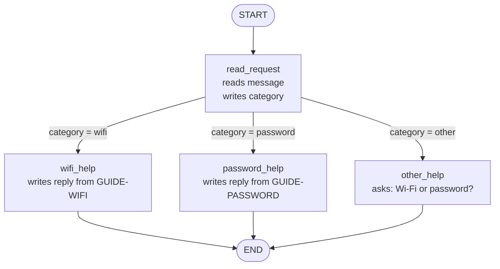
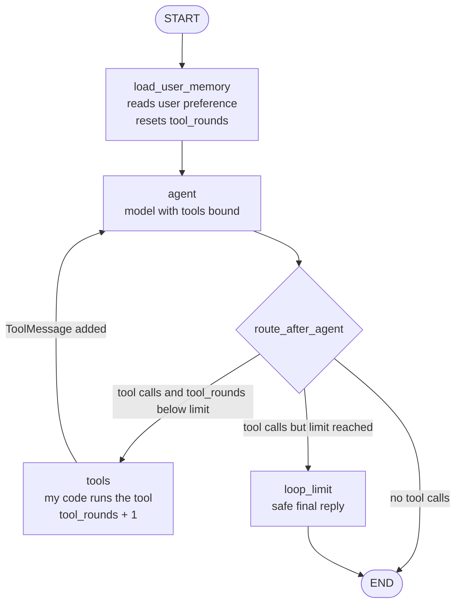
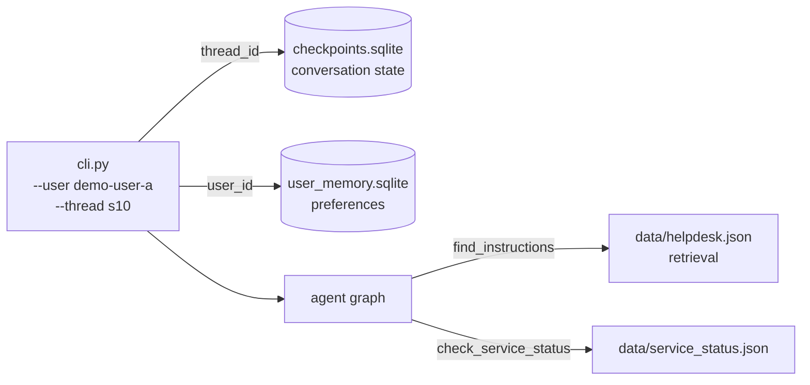

# HW5: My LangGraph helpdesk

<!--
МЕТКИ В ЭТОМ ФАЙЛЕ
TODO(you)  : пишешь ты сам, своими словами (прогнозы, ответы на вопросы, выводы)
TODO(run)  : заполняется после реального запуска, из наших логов
TODO(pin)  : точные версии и команды, уточним, когда код запустится
Перед сдачей: поиск по "TODO" должен ничего не находить.
Подсказки в таких комментариях на GitHub не видны, но перед сдачей их лучше удалить.
-->

| | |
| --- | --- |
| Student | TODO(you): name |
| Student ID | s23069008 |
| Group | CSS4007-ENG-8 |
| Repository | https://github.com/armansarsenbayev/css4007-hw5 |
| Model and provider (Parts 2 and 3) | TODO(pin): gpt-5.6-luna via TODO provider |
| Python version | TODO(pin) |
| LangGraph version | TODO(pin) |

### Use of AI

TODO(you): check and edit this paragraph so it is true.

I used Claude (Anthropic) as an assistant. It drew the planned graph diagrams, wrote most of the Python code, the tests and the GitHub Actions workflow, and ran the scenario scripts. I wrote the route predictions before any code was run, answered the state and routing questions in my own words, ran the program on my own computer, compared predictions with the traces and wrote the conclusions. I reviewed every file before committing it.

### Repository layout

| Path | What it contains |
| --- | --- |
| `helpdesk/data.py` | Loads `helpdesk.json`, `service_status.json` and `ticket_template.json` |
| `helpdesk/part1_graph.py` | Part 1 rule based graph, two variants: `original` and `with_clarification` |
| `helpdesk/tools.py` | `find_instructions`, `check_service_status`, `prepare_ticket`, `save_user_preference` |
| `helpdesk/agent_graph.py` | Parts 2 and 3: model and tools graph with the loop limit and memory nodes |
| `helpdesk/memory.py` | Paths to the checkpointer database and the user preference store |
| `helpdesk/tracing.py` | Writes one JSON trace per scenario into `outputs/` |
| `helpdesk/cli.py` | Terminal program: user id, thread id and status profile are command line options |
| `helpdesk/scenarios.py` | Runs S01 to S14 from `data/scenarios.json`, with real process restarts |
| `tests/` | Pytest tests, no API key needed (fake model) |
| `.github/workflows/tests.yml` | CI: runs the tests on every push |
| `outputs/` | Scenario logs `S01.json` to `S14.json`, ticket drafts in `outputs/tickets/` |
| `local-storage/` | Live memory databases (ignored by git) |

---

## Part 1: How the graph works

### My graph and state

State (`HelpdeskState`, a `TypedDict`):

| Field | What it holds | Set by |
| --- | --- | --- |
| `message` | The user's original message, never changed | input at `START` |
| `category` | `wifi`, `password`, `other` (and `both` in the changed graph) | `read_request` |
| `reply` | The text shown to the user | one help node |

Planned graph, drawn before writing code:



What each node reads and changes:

| Node or function | Reads from state | Also reads | Writes to state |
| --- | --- | --- | --- |
| `read_request` (node) | `message` | `topic_aliases` in `helpdesk.json` | `category` |
| `route_by_category` (conditional edge function, not a node) | `category` | nothing | nothing, it only returns the name of the next node |
| `wifi_help` (node) | nothing needed | `instructions.wifi` in `helpdesk.json` | `reply` |
| `password_help` (node) | nothing needed | `instructions.password` in `helpdesk.json` | `reply` |
| `other_help` (node) | nothing needed | `scope` in `helpdesk.json` | `reply` (a question) |

Routing rules inside `read_request`, checked in this order after `message.lower()`:

1. contains `wifi` or `wi-fi` → `category = "wifi"`
2. otherwise contains `password` → `category = "password"`
3. otherwise → `category = "other"`

The aliases are read from `topic_aliases` in `helpdesk.json`, not typed into the code.

Graph generated from the compiled code with `app.get_graph().draw_mermaid()`, to check that the code matches the plan:

TODO(run): paste the generated diagram here.

**Answers to the four questions**

1. What information does each node need to read? What does it change?
   TODO(you)
   <!-- можно опираться на таблицу выше, но сформулируй сам -->
2. What is the difference between a node returning an update to the state and a conditional edge choosing the next node?
   TODO(you)
3. Does the next node receive only the previous node's update, or the current graph state?
   TODO(you)
   <!-- пример с "The WIFI is very slow today" из гайда, раздел 2 -->
4. What do `START`, `END`, and compiling a graph mean in this program?
   TODO(you)

### Predictions before running

TODO(you): fill the "Predicted route" column and commit it before running any code (commit `Part 1: route predictions written before running the graph`). The commit time is my evidence.

| Message | Predicted route | Actual route | What I learned |
| --- | --- | --- | --- |
| I cannot connect to Wi-Fi. | TODO(you) | TODO(run) | TODO(you) |
| I forgot my PASSWORD. | TODO(you) | TODO(run) | TODO(you) |
| My laptop screen is broken. | TODO(you) | TODO(run) | TODO(you) |
| My Wi-Fi password does not work. | TODO(you) | TODO(run) | TODO(you) |

Command for each run (example):

```bash
python -m helpdesk.part1 --variant original --message "I cannot connect to Wi-Fi."
```

Each run saves the order of nodes and the full state after every node (`stream_mode="values"`) together with each node's own update (`stream_mode="updates"`). Logs: `outputs/S01.json` to `outputs/S04.json`.

Message with both topics in the original graph:

TODO(you): explain what happened with "My Wi-Fi password does not work." and which rule caused it.

### My change to the graph

The new rule is checked first: if the message contains a Wi-Fi alias **and** a password alias, `category = "both"` and the edge sends it to `clarify_problem`, which asks: "Is the problem connecting to Wi-Fi, or recovering your account password?"


Command:

```bash
python -m helpdesk.part1 --variant with_clarification --message "My Wi-Fi password does not work."
```

New trace (`outputs/S05.json`):

TODO(run): paste the short node order and state after each node, compare with S04.

What changed: TODO(you)
<!-- главное: изменился маршрут в графе (новый узел и новое значение category), а не только текст ответа -->

**What LangGraph controls and what my functions decide**

TODO(you)
<!-- LangGraph: порядок вызова узлов, слияние обновлений в state, вызов функции ребра и переход. Твои функции: категория, выбор дороги, текст ответа. Модели здесь нет. -->

---

## Part 2: Model and tools

### Model and provider

TODO(pin): `MODEL_NAME=...`, provider, base URL, temperature and reasoning settings.
<!-- по опыту HW4: luna принимает только temperature 1, для tool calls нужен reasoning_effort="none" -->

### Tools

Each tool is a plain Python function first, then wrapped as a LangChain tool. The model chooses only the arguments in the "Model chooses" column. The status profile, user id and thread id come from the application (run configuration), so the model can never pick a different snapshot or another user's data.

| Tool | Model chooses | Application supplies | Returns | Reads or writes |
| --- | --- | --- | --- | --- |
| `find_instructions` | `topic`: `wifi` or `password` | nothing | `instruction_id`, `title`, `steps`, `source` | reads `data/helpdesk.json` |
| `check_service_status` | `service`: `wifi` or `account_recovery` | `status_profile` | `service`, `status` (`operational`, `outage` or `unknown`), `message`, `status_profile` | reads `data/service_status.json` |
| `prepare_ticket` | `category`, `summary`, `steps_tried`, `service_status` | `user_id`, `thread_id`, `status_profile` | `ticket_id`, `file`, or `needs_info` with the missing fields | writes `outputs/tickets/<ticket_id>.json` |
| `save_user_preference` (Part 3) | `language` | `user_id` | confirmation | writes the user preference store |

Rules built into the tools, not left to the model:

* An unknown topic or service returns an error with the allowed values instead of crashing.
* `unknown` status is reported as unknown, never as operational or as an outage.
* `prepare_ticket` refuses to write a draft when the summary or the steps tried are missing and returns `needs_info`, so the assistant has to ask the user (S09).
* `prepare_ticket` refuses text that looks like a password or a recovery code.
* `service_status` in the ticket is `not checked` when the status was not looked up.
* A ticket is a local draft. Nothing is sent anywhere.

Direct calls without the agent:

```bash
python -m helpdesk.tools find_instructions wifi
python -m helpdesk.tools check_service_status wifi --profile wifi_outage
python -m helpdesk.tools prepare_ticket --category wifi --summary "Campus-Demo will not connect" --step "Enabled Wi-Fi" --step "Forgot the saved network"
```

TODO(run): paste the three outputs.

### The execution loop



State for Parts 2 and 3:

| Field | What it holds |
| --- | --- |
| `messages` | Conversation messages with the `add_messages` reducer (new messages are appended, not replaced) |
| `user_preference` | Language loaded from user memory at the start of each turn, or none |
| `tool_rounds` | Number of tool rounds in the current turn |
| `loop_limit_reached` | `True` if the limit stopped the loop |

**Loop limit.** `MAX_TOOL_ROUNDS = 4`, enforced in `route_after_agent`, the conditional edge after the `agent` node. The longest planned turn (S06, second message) needs 2 rounds: `check_service_status`, then `prepare_ticket`. If the model still asks for a tool after 4 rounds, the edge goes to `loop_limit` instead of `tools`, and the trace records `loop_limit_reached: true`. LangGraph's own `recursion_limit` stays as a second safety net.

**Answers to the four questions**

1. How does the graph decide between running a tool and ending with an answer?
   TODO(you)
2. Which component requests a tool, and which component actually executes it?
   TODO(you)
3. What changes in the state after a tool result returns?
   TODO(you)
4. What makes this part different from the fixed routing rules in Part 1?
   TODO(you)

### A real run with several tools

S06, second message, profile `normal`. Log: `outputs/S06.json`.

TODO(run): model requests, tool results and final answer.

### The same request with three snapshots

| Snapshot | Scenario | Status returned | What the assistant did | Ticket file |
| --- | --- | --- | --- | --- |
| `normal` | S06 | TODO(run) | TODO(run) | TODO(run) |
| `wifi_outage` | S07 | TODO(run) | TODO(run) | none expected |
| `status_unavailable` | S08 | TODO(run) | TODO(run) | none expected |

TODO(you): one or two sentences on why the behaviour changed with the data.

---

## Part 3: Memory

### Design

| | Conversation memory | User memory |
| --- | --- | --- |
| What | Messages, current problem, steps already tried | Saved preference, for example reply language |
| Key | `thread_id` | `user_id` |
| Storage | LangGraph `SqliteSaver` checkpointer | LangGraph `SqliteStore`, namespace `("users", user_id)`, key `preferences` |
| File | `local-storage/checkpoints.sqlite` | `local-storage/user_memory.sqlite` |
| Written | automatically after every graph step | only when the model calls `save_user_preference` |
| Read | automatically when the graph is invoked with the same `thread_id` | by the `load_user_memory` node at the start of every turn |
| Shared across threads | no | yes, for the same user only |



The user id and thread id are given on the command line by the person running the program. The model never chooses which user's data is loaded.

`demo_users.json` is not used as memory and the language preference is not hard coded. It is learned from a message and saved.

**thread_id versus user_id, retrieval versus memory**

TODO(you)
<!-- thread_id: один разговор; user_id: человек, у которого может быть много разговоров. Инструкции по Wi-Fi одинаковые для всех и лежат в справочнике (retrieval), язык это факт о конкретном пользователе, который он сам сообщил (memory). -->

### Demonstrations

| Situation | Command used | Log file | What happened |
| --- | --- | --- | --- |
| Refer to an earlier message | `python -m helpdesk.scenarios S10` | `outputs/S10.json` | TODO(run) |
| Close, restart and resume | `python -m helpdesk.scenarios S11` | `outputs/S11.json` | TODO(run) |
| Same user, new conversation | `python -m helpdesk.scenarios S12` | `outputs/S12.json` | TODO(run) |
| Different user | `python -m helpdesk.scenarios S13` | `outputs/S13.json` | TODO(run) |

How the restart is real: the scenario runner starts a new Python process (`python -m helpdesk.cli ...`) for every group of events between `restart_process` events. The first process exits completely before the second one starts, and both use the same `local-storage/` files. Each log records the process id of every segment, so the reader can see they differ.

Manual version of S11 for the report:

```bash
python -m helpdesk.cli --user demo-user-a --thread restart-a --status normal
# type the first message, then /quit
python -m helpdesk.cli --user demo-user-a --thread restart-a --status normal
# type: Which problem and steps did we discuss?
```

For each demonstration, the log lists where each piece of information came from: `conversation memory` (checkpoint), `user memory` (store) or `reference file` (`helpdesk.json`, `service_status.json`).

---

## Part 4: Running and checking my work

* Setup, API key configuration, run commands and Python version: see [README.md](README.md).
* Exact package versions: `requirements.txt` (pinned with `==`). TODO(pin)
* Memory files: `local-storage/checkpoints.sqlite` and `local-storage/user_memory.sqlite`. Clear everything with `python -m helpdesk.cli --reset`, or delete the `local-storage/` folder. The scenario runner resets them itself when `reset_before` is true.
* CI: `.github/workflows/tests.yml` runs `pytest` on every push and pull request. It has no API key and uses the fake model.

### Tests and what each one would catch

| Test file | What it checks | Mistake it would catch |
| --- | --- | --- |
| `test_part1_routing.py` | The four messages, uppercase and lowercase variants, both topics in each graph variant | Rule order changed, `lower()` removed, `clarify_problem` not connected |
| `test_tools.py` | Each tool called directly: instructions for both topics, every service in every snapshot, ticket file contents | `unknown` treated as operational, password mapped to the wrong service, ticket missing template fields or containing invented steps |
| `test_ticket_rules.py` | Missing summary or steps, secret looking text | A draft written without the user's details, a password saved in a ticket |
| `test_agent_loop.py` | Fake model asks for a tool, the result returns, then it answers; fake model that asks for tools forever | Tool results not returned to the model, loop limit missing or in the wrong place |
| `test_memory_restart.py` | Writes a conversation and a preference in one subprocess, reads them back in a new subprocess | State kept only in RAM, wrong storage path |
| `test_isolation.py` | Preference of `demo-user-a` invisible to `demo-user-b`; a new thread does not contain old messages | Store namespace without `user_id`, checkpoints not separated by `thread_id` |

**Fake model.** `tests/fake_model.py` contains `ScriptedChatModel`, a clearly labelled test double that returns prepared messages and tool calls in a fixed order. It is used only in tests. The real model demonstrations in Parts 2 and 3 were run separately with an API key, and their logs are in `outputs/`.

---

## Choices and limitations

**Choices**

* LangGraph `SqliteSaver` for conversations: it is the supplied package, needs no server and keeps one file that survives restarts.
* LangGraph `SqliteStore` for user preferences: it keeps user memory separate from conversation checkpoints, so one user's preference can be read from any of that user's threads but not from another user's threads.
* Status profile, user id and thread id are run configuration, not model arguments.
* Tool rules (unknown status, missing details, secrets) live in Python, so they hold even if the model makes a mistake.

**Limitations**

TODO(run): fill after the real runs. Expected candidates:
* Part 1 matches substrings only: "Wi Fi", "pass word" or a Russian message go to `other_help`.
* Whether the model calls `save_user_preference` depends on the model; a missed call means the preference is not saved.
* Results come from a small number of runs with one model.

---

## Supplied scenarios: my actual results

Logs are in `outputs/`, one file per scenario. Run any scenario with `python -m helpdesk.scenarios <ID>`, or all of them with `python -m helpdesk.scenarios all`.

| Scenario | Command or manual steps | Log file | What happened / what I changed |
| --- | --- | --- | --- |
| S01: Simple Wi-Fi route | `python -m helpdesk.scenarios S01` | `outputs/S01.json` | TODO(run) |
| S02: Case-insensitive password route | `python -m helpdesk.scenarios S02` | `outputs/S02.json` | TODO(run) |
| S03: Unsupported request | `python -m helpdesk.scenarios S03` | `outputs/S03.json` | TODO(run) |
| S04: Two topics before the graph change | `python -m helpdesk.scenarios S04` (original graph) | `outputs/S04.json` | TODO(run) |
| S05: Two topics after adding clarification | `python -m helpdesk.scenarios S05` (with_clarification graph) | `outputs/S05.json` | TODO(run) |
| S06: Instructions then local ticket | `python -m helpdesk.scenarios S06` | `outputs/S06.json` | TODO(run) |
| S07: The same request during a Wi-Fi outage | `python -m helpdesk.scenarios S07` | `outputs/S07.json` | TODO(run) |
| S08: Status source unavailable | `python -m helpdesk.scenarios S08` | `outputs/S08.json` | TODO(run) |
| S09: Missing ticket details | `python -m helpdesk.scenarios S09` | `outputs/S09.json` | TODO(run) |
| S10: Use the current conversation | `python -m helpdesk.scenarios S10` | `outputs/S10.json` | TODO(run) |
| S11: Persist and recall after restart | `python -m helpdesk.scenarios S11` (two processes) | `outputs/S11.json` | TODO(run) |
| S12: Preference across threads without replay | `python -m helpdesk.scenarios S12` (two processes) | `outputs/S12.json` | TODO(run) |
| S13: Do not share memory between users | `python -m helpdesk.scenarios S13` | `outputs/S13.json` | TODO(run) |
| S14: Password recovery outage | `python -m helpdesk.scenarios S14` | `outputs/S14.json` | TODO(run) |

**S04 versus S05:** TODO(you)

**S06 versus S07 versus S08:** TODO(you)
