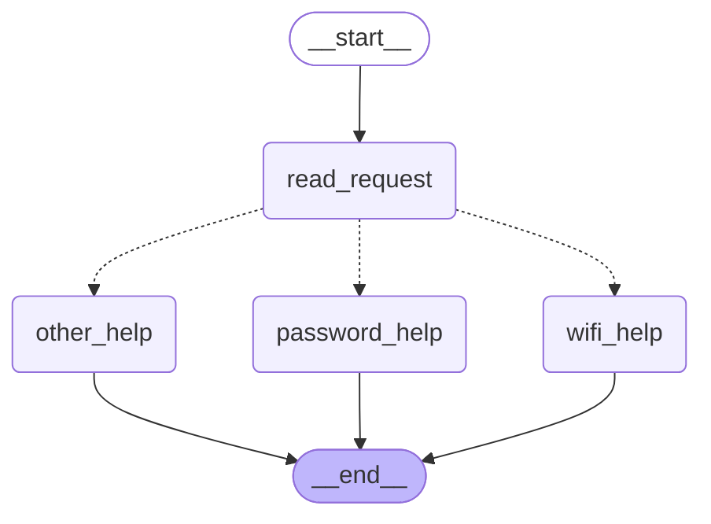
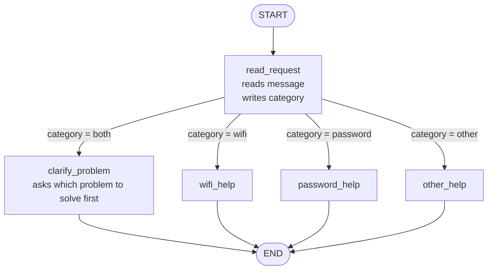
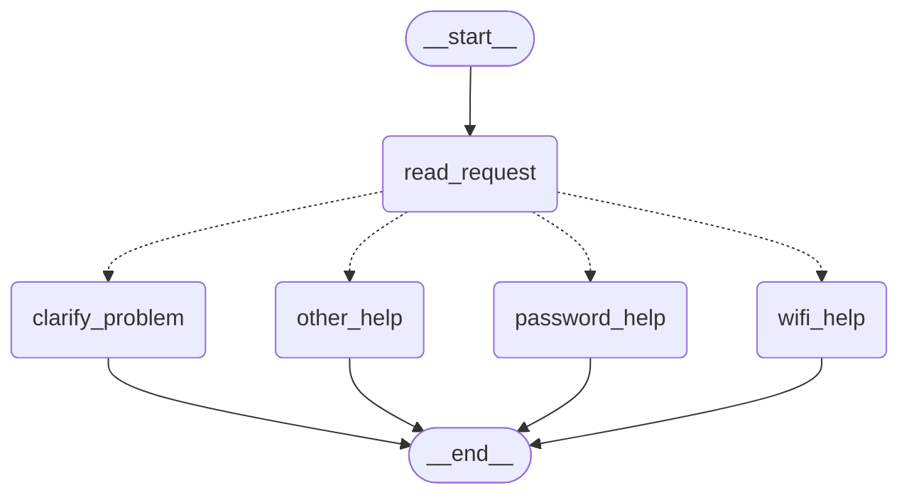
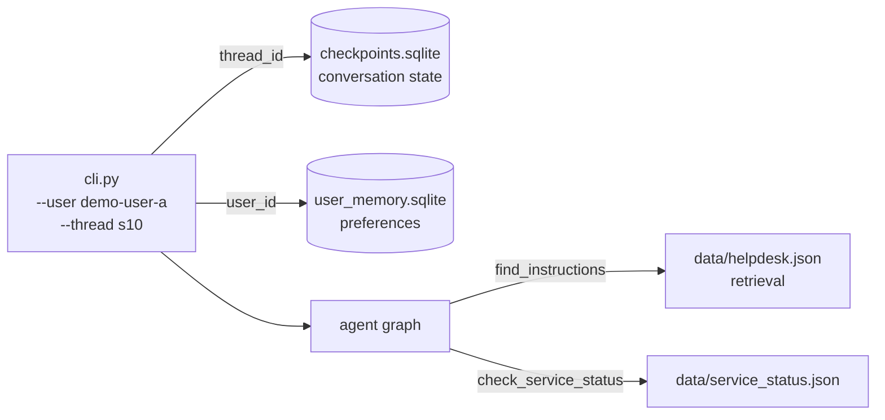

# HW5: My LangGraph helpdesk

<!--
МЕТКИ В ЭТОМ ФАЙЛЕ
TODO(you)  : пишешь ты сам, своими словами (прогнозы, ответы на вопросы, выводы)
TODO(run)  : заполняется после реального запуска, из наших логов
TODO(pin)  : точные версии и команды, уточним, когда код запустится
Перед сдачей: поиск по "TODO" должен ничего не находить.
Подсказки в таких комментариях на GitHub не видны, но перед сдачей их лучше удалить.
-->

| | |
| --- | --- |
| Student | Arman Sarsenbayev |
| Student ID | s23069008 |
| Group | CSS4007-ENG-8 |
| Repository | https://github.com/armansarsenbayev/css4007-hw5 |
| Model and provider (Parts 2 and 3) | `gpt-5.6-luna` via the OpenAI API (`api.openai.com`, `langchain-openai` 1.7.4) |
| Python version | 3.11.1 |
| LangGraph version | `langgraph` 1.2.20, `langgraph-checkpoint-sqlite` 3.1.3 |

### Use of AI

TODO(you): check and edit this paragraph so it is true.

I used Claude (Anthropic) as an assistant. It drew the planned graph diagrams, wrote most of the Python code, the tests and the GitHub Actions workflow, and ran the scenario scripts. I wrote the route predictions before any code was run, answered the state and routing questions in my own words, ran the program on my own computer, compared predictions with the traces and wrote the conclusions. I reviewed every file before committing it.

### Repository layout

| Path | What it contains |
| --- | --- |
| `helpdesk/data.py` | Loads `helpdesk.json`, `service_status.json` and `ticket_template.json` |
| `helpdesk/part1_graph.py` | Part 1 rule based graph, two variants: `original` and `with_clarification` |
| `helpdesk/tools.py` | `find_instructions`, `check_service_status`, `prepare_ticket`, `save_user_preference` |
| `helpdesk/agent_graph.py` | Parts 2 and 3: model and tools graph with the loop limit and memory nodes |
| `helpdesk/memory.py` | Paths to the checkpointer database and the user preference store |
| `helpdesk/tracing.py` | Writes one JSON trace per scenario into `outputs/` |
| `helpdesk/cli.py` | Terminal program: user id, thread id and status profile are command line options |
| `helpdesk/scenarios.py` | Runs S01 to S14 from `data/scenarios.json`, with real process restarts |
| `tests/` | Pytest tests, no API key needed (fake model) |
| `.github/workflows/tests.yml` | CI: runs the tests on every push |
| `outputs/` | Scenario logs `S01.json` to `S14.json`, ticket drafts in `outputs/tickets/` |
| `local-storage/` | Live memory databases (ignored by git) |

---

## Part 1: How the graph works

### My graph and state

State (`HelpdeskState`, a `TypedDict`):

| Field | What it holds | Set by |
| --- | --- | --- |
| `message` | The user's original message, never changed | input at `START` |
| `category` | `wifi`, `password`, `other` (and `both` in the changed graph) | `read_request` |
| `reply` | The text shown to the user | one help node |

Planned graph, drawn before writing code:


What each node reads and changes:

| Node or function | Reads from state | Also reads | Writes to state |
| --- | --- | --- | --- |
| `read_request` (node) | `message` | `topic_aliases` in `helpdesk.json` | `category` |
| `route_by_category` (conditional edge function, not a node) | `category` | nothing | nothing, it only returns the name of the next node |
| `wifi_help` (node) | nothing needed | `instructions.wifi` in `helpdesk.json` | `reply` |
| `password_help` (node) | nothing needed | `instructions.password` in `helpdesk.json` | `reply` |
| `other_help` (node) | nothing needed | `scope` in `helpdesk.json` | `reply` (a question) |

Routing rules inside `read_request`, checked in this order after `message.lower()`:

1. contains `wifi` or `wi-fi` → `category = "wifi"`
2. otherwise contains `password` → `category = "password"`
3. otherwise → `category = "other"`

The aliases are read from `topic_aliases` in `helpdesk.json`, not typed into the code.

Graph generated from the compiled code with `app.get_graph().draw_mermaid()`, to check that the code matches the plan:

Output of `python -m helpdesk.part1 --variant original --mermaid` (dotted arrows are the conditional edge):



It matches the planned graph: one fixed edge into `read_request`, three conditional branches, every help node ends at `END`.

**Answers to the four questions**

1. What information does each node need to read? What does it change?
   Read Request node reads information about state of the message and helpdesk json file. wifi_help note reads the instructions.wifi and helpdesk file. password_help reads instruction.password and also helpdesk. and finally, other_help needs also helpdesk.json file.
2. What is the difference between a node returning an update to the state and a conditional edge choosing the next node?
   Node update a state of an object if its changed when called,e.g category: wifi it updates state "category", then conditional edge choose the next node for it and defines the route, e.g wifi: wifi_help
3. Does the next node receive only the previous node's update, or the current graph state?
   Next node receive the current graph state, previous node returns its current update to the langgraph. after that it puts its state to global "memory" which other nodes can use.
   
4. What do `START`, `END`, and compiling a graph mean in this program?
   START is the virtual entry that delivers user input into the graph, in our program it give the message to a first node. End is last exit, iwhen program should stop in our case when reply is sent by help function. Invoke check the final state. Compiling is checking if the langgrapg is working correctly. For example, if all nodes and edges connected from start to end and all edge has existing node.

### Predictions before running

| Message | Predicted route | Actual route | What I learned |
| --- | --- | --- | --- |
| I cannot connect to Wi-Fi. | START → read_request → wifi_help → END | START → read_request (`category: wifi`) → wifi_help → END (S01) | same |
| I forgot my PASSWORD. | START → read_request → password_help → END | START → read_request (`category: password`) → password_help → END (S02) | same |
| My laptop screen is broken. | START → read_request → other_help → END | START → read_request (`category: other`) → other_help → END (S03) | same |
| My Wi-Fi password does not work. | START → read_request → wifi_help → END | START → read_request (`category: wifi`) → wifi_help → END (S04) | same |

Command for each run (example):

```bash
python -m helpdesk.part1 --variant original --message "I cannot connect to Wi-Fi."
```

Each run saves the order of nodes and the full state after every node (`stream_mode="values"`) together with each node's own update (`stream_mode="updates"`). Logs: `outputs/S01.json` to `outputs/S04.json`.

Message with both topics in the original graph:

It goes to wifi_help because it goes first in code.

### My change to the graph

The new rule is checked first: if the message contains a Wi-Fi alias **and** a password alias, `category = "both"` and the edge sends it to `clarify_problem`, which asks: "Is the problem connecting to Wi-Fi, or recovering your account password?"



Command:

```bash
python -m helpdesk.part1 --variant with_clarification --message "My Wi-Fi password does not work."
```

New trace (`outputs/S05.json`):

Generated diagram of the changed graph (`--variant with_clarification --mermaid`), the new node and branch are present:



Same message, both logs:

| Step | S04 (`original`) | S05 (`with_clarification`) |
| --- | --- | --- |
| 1. `read_request` update | `{"category": "wifi"}` | `{"category": "both"}` |
| state after 1 | `message`, `category: wifi` | `message`, `category: both` |
| edge chose | `wifi_help` | `clarify_problem` |
| 2. update | `reply`: "Connect to the practice campus network (GUIDE-WIFI) 1. Check that Wi-Fi is enabled ..." | `reply`: "Is the problem connecting to Wi-Fi, or recovering your account password?" |
| state after 2 | `message`, `category: wifi`, `reply` | `message`, `category: both`, `reply` |
| then | END | END |

What changed: Added a new node and new category both which help to determine the exact problem

**What LangGraph controls and what my functions decide**

LangGraph decides the sequence of nodes and state merging, also call of edges. My function decides the category, trace and reply

---

## Part 2: Model and tools

### Model and provider

`MODEL_NAME=gpt-5.6-luna`, provider OpenAI (`OPENAI_BASE_URL` empty, so `api.openai.com`), `MODEL_TEMPERATURE=1` (the only value this model accepts), `MODEL_REASONING_EFFORT=none` (needed for tool calls with this model). Built in `helpdesk/model.py` with `ChatOpenAI` from `langchain-openai` 1.7.4. All settings are read from `.env`; an empty value is not sent.

### Tools

Each tool is a plain Python function first, then wrapped as a LangChain tool. The model chooses only the arguments in the "Model chooses" column. The status profile, user id and thread id come from the application (run configuration), so the model can never pick a different snapshot or another user's data.

| Tool | Model chooses | Application supplies | Returns | Reads or writes |
| --- | --- | --- | --- | --- |
| `find_instructions` | `topic`: `wifi` or `password` | nothing | `instruction_id`, `title`, `steps`, `source` | reads `data/helpdesk.json` |
| `check_service_status` | `service`: `wifi` or `account_recovery` | `status_profile` | `service`, `status` (`operational`, `outage` or `unknown`), `message`, `status_profile` | reads `data/service_status.json` |
| `prepare_ticket` | `category`, `summary`, `steps_tried`, `service_status` | `user_id`, `thread_id`, `status_profile` | `ticket_id`, `file`, or `needs_info` with the missing fields | writes `outputs/tickets/<ticket_id>.json` |
| `save_user_preference` (Part 3) | `language` | `user_id` | confirmation | writes the user preference store |

Rules built into the tools, not left to the model:

* An unknown topic or service returns an error with the allowed values instead of crashing.
* `unknown` status is reported as unknown, never as operational or as an outage.
* `prepare_ticket` refuses to write a draft when the summary or the steps tried are missing and returns `needs_info`, so the assistant has to ask the user (S09).
* `prepare_ticket` refuses text that looks like a password or a recovery code.
* `service_status` in the ticket is `not checked` when the status was not looked up.
* A ticket is a local draft. Nothing is sent anywhere.

Direct calls without the agent:

```bash
python -m helpdesk.tools find_instructions wifi
python -m helpdesk.tools check_service_status wifi --profile wifi_outage
python -m helpdesk.tools prepare_ticket --category wifi --summary "Campus-Demo will not connect" --step "Enabled Wi-Fi" --step "Forgot the saved network"
```

Outputs:

```json
{
  "instruction_id": "GUIDE-WIFI",
  "title": "Connect to the practice campus network",
  "steps": [
    "Check that Wi-Fi is enabled and airplane mode is off.",
    "Select the fictional Campus-Demo network.",
    "If connection fails, forget the saved network and try connecting again.",
    "If the problem remains, check the service status before preparing a ticket."
  ],
  "source": "data/helpdesk.json"
}
```

```json
{
  "service": "wifi",
  "status": "outage",
  "message": "The demo Wi-Fi service is unavailable across campus. The fixture gives no repair time.",
  "status_profile": "wifi_outage",
  "source": "data/service_status.json"
}
```

```json
{
  "ticket_id": "TKT-20261109-225025-d6bd",
  "file": "local-storage/manual-tickets/TKT-20261109-225025-d6bd.json",
  "sent": false
}
```

The third run was made with `HELPDESK_TICKET_DIR=local-storage/manual-tickets` so this manual test draft stays out of `outputs/tickets/`. The draft holds the two given steps only and `"service_status": "not checked"`, because no status was passed.

### The execution loop


State for Parts 2 and 3:

| Field | What it holds |
| --- | --- |
| `messages` | Conversation messages with the `add_messages` reducer (new messages are appended, not replaced) |
| `user_preference` | Language loaded from user memory at the start of each turn, or none |
| `tool_rounds` | Number of tool rounds in the current turn |
| `loop_limit_reached` | `True` if the limit stopped the loop |

**Loop limit.** `MAX_TOOL_ROUNDS = 4`, enforced in `route_after_agent`, the conditional edge after the `agent` node. The longest planned turn (S06, second message) needs 2 rounds: `check_service_status`, then `prepare_ticket`. If the model still asks for a tool after 4 rounds, the edge goes to `loop_limit` instead of `tools`, and the trace records `loop_limit_reached: true`. LangGraph's own `recursion_limit` stays as a second safety net.

**Answers to the four questions**

1. How does the graph decide between running a tool and ending with an answer?
   After every `agent` node the conditional edge `route_after_agent` looks at the last message in `messages`. If the model's `AIMessage` contains `tool_calls` and `tool_rounds` is below `MAX_TOOL_ROUNDS` (4), it returns `"tools"`. If there are tool calls but the limit is reached, it returns `"loop_limit"`. If there are no tool calls, the message is a final answer and it returns `END`. So the model influences the route only through what it writes in its message; the decision itself is my Python function.
2. Which component requests a tool, and which component actually executes it?
   The model requests it: in the `agent` node it returns an `AIMessage` with a tool name and arguments (for example `check_service_status {"service": "wifi"}`). It cannot run anything itself. My own `tools` node executes it: it checks the tool name and arguments, adds the values the application controls (`status_profile`, `user_id`, `thread_id`, the store) from the run context, calls the Python function and wraps the result in a `ToolMessage`. Unknown tools or bad arguments become an error message instead of a crash.
3. What changes in the state after a tool result returns?
   The `tools` node returns `{"messages": [ToolMessage...], "tool_rounds": tool_rounds + 1}`. Because `messages` uses the `add_messages` reducer, the `ToolMessage` (JSON result plus the matching `tool_call_id`) is appended to the conversation, not replacing it, and the round counter grows by one. Then the edge goes back to `agent`, so the model sees its own request and the result and decides the next step. In S06 the state after round 1 held the `operational` status, and only then did the model ask for `prepare_ticket`. A ticket file on disk or a saved preference in the store are side effects outside the graph state.
4. What makes this part different from the fixed routing rules in Part 1?
   In Part 1 the route is fully decided by my `if` rules on the message text: the same message always gives the same path, and the graph is a straight line with no loop. In Part 2 the model reads the conversation and decides which tool to call, with which arguments, and when to stop. The path can loop through `tools` several times and depends on tool results: the same request created a ticket with `normal` (S06) but not with `wifi_outage` (S07) or `status_unavailable` (S08). What stays fixed is the frame around the model: the graph structure, the loop limit, the tool rules and the application values that the model cannot change.

### A real run with several tools

S06, second message, profile `normal`. Log: `outputs/S06.json`.

Nodes: `load_user_memory > agent > tools > agent > tools > agent`, `tool_rounds: 2`, `loop_limit_reached: false`. Before the turn the checkpoint already held 4 messages from the first turn (sources: conversation memory, status snapshot: normal).

| Round | Model request | Tool result (run by my `tools` node) |
| --- | --- | --- |
| 1 | `check_service_status {"service": "wifi"}` | `{"status": "operational", "message": "The demo Wi-Fi service has no reported outage.", "status_profile": "normal"}` |
| 2 | `prepare_ticket {"category": "wifi", "summary": "Campus-Demo still will not connect", "steps_tried": ["Enabled Wi-Fi", "Forgot the saved network"], "service_status": "operational"}` | `{"ticket_id": "TKT-20261109-224718-a6ee", "file": "outputs/tickets/TKT-20261109-224718-a6ee.json", "sent": false}` |

The model asked for `prepare_ticket` only after the status came back `operational`. Final answer:

> Wi-Fi is operational with no reported outage. Ticket draft prepared: Ticket ID: TKT-20261109-224718-a6ee, File: `outputs/tickets/TKT-20261109-224718-a6ee.json`. Nothing was sent.

The steps in the ticket are exactly the two the user named; no guide steps were added.

### The same request with three snapshots

| Snapshot | Scenario | Status returned | What the assistant did | Ticket file |
| --- | --- | --- | --- | --- |
| `normal` | S06 | `operational` | Called `prepare_ticket` in round 2 and gave the id and file, said nothing was sent | `outputs/tickets/TKT-20261109-224718-a6ee.json` |
| `wifi_outage` | S07 | `outage` | No `prepare_ticket` call. "Wi-Fi is currently experiencing a campus-wide outage, so I did not prepare a ticket. No repair time is available." | none (none expected) |
| `status_unavailable` | S08 | `unknown` | No `prepare_ticket` call. "Wi-Fi status could not be determined ... so I did not prepare a ticket. Would you like a ticket draft noting that the status could not be checked?" | none (none expected) |

The code, the prompt and the user's message were the same in all three runs; only the `--status` snapshot chosen by the application changed, so `check_service_status` returned `operational`, `outage` or `unknown`. That result went back to the model as a `ToolMessage`, and the model applied the user's condition ("if it is operating, prepare a ticket") to it: it called `prepare_ticket` only for `operational`, refused for `outage`, and for `unknown` asked instead of guessing.

---

## Part 3: Memory

### Design

| | Conversation memory | User memory |
| --- | --- | --- |
| What | Messages, current problem, steps already tried | Saved preference, for example reply language |
| Key | `thread_id` | `user_id` |
| Storage | LangGraph `SqliteSaver` checkpointer | LangGraph `SqliteStore`, namespace `("users", user_id)`, key `preferences` |
| File | `local-storage/checkpoints.sqlite` | `local-storage/user_memory.sqlite` |
| Written | automatically after every graph step | only when the model calls `save_user_preference` |
| Read | automatically when the graph is invoked with the same `thread_id` | by the `load_user_memory` node at the start of every turn |
| Shared across threads | no | yes, for the same user only |



The user id and thread id are given on the command line by the person running the program. The model never chooses which user's data is loaded.

`demo_users.json` is not used as memory and the language preference is not hard coded. It is learned from a message and saved.

**thread_id versus user_id, retrieval versus memory**

TODO(you)
<!-- thread_id: один разговор; user_id: человек, у которого может быть много разговоров. Инструкции по Wi-Fi одинаковые для всех и лежат в справочнике (retrieval), язык это факт о конкретном пользователе, который он сам сообщил (memory). -->

### Demonstrations

| Situation | Command used | Log file | What happened |
| --- | --- | --- | --- |
| Refer to an earlier message | `python -m helpdesk.scenarios S10` | `outputs/S10.json` | Turn 2 "Which steps did I already try?": 6 messages read from the checkpoint, no tools, sources `conversation memory`. Reply: "Enabling Wi-Fi, Forgetting the saved network, Reconnecting, which failed". |
| Close, restart and resume | `python -m helpdesk.scenarios S11` | `outputs/S11.json` | Turn 1 in process 10208 called `save_user_preference {"language": "Kazakh"}`. Turn 2 in a new process 1648: 7 messages read from the checkpoint and `{"language": "Kazakh"}` from the store, sources `conversation memory, user memory`. Reply in Kazakh: we discussed a Wi-Fi problem; you said you enabled Wi-Fi and tried reconnecting. |
| Same user, new conversation | `python -m helpdesk.scenarios S12` | `outputs/S12.json` | Thread `preference-a2` in new process 6624: 0 messages before the turn, user memory `{"language": "Kazakh"}`, sources `user memory` only. Reply in Kazakh: "Сіз қазақ тілін қолдануды сұрадыңыз" (you asked for Kazakh), then the scope list. |
| Different user | `python -m helpdesk.scenarios S13` | `outputs/S13.json` | `demo-user-b`: 0 messages, user memory `null`, sources none. Reply in English: "No. No preferred language or previous problem has been recorded in this conversation." |

How the restart is real: the scenario runner starts a new Python process (`python -m helpdesk.scenarios --segment <ID> <INDEX>`, launched with `subprocess.run` by `python -m helpdesk.scenarios <ID>`) for every group of events between `restart_process` events. The first process exits completely before the second one starts, and both use the same `local-storage/` files. Each log records the process id of every segment, so the reader can see they differ.

Manual version of S11 for the report:

```bash
python -m helpdesk.cli --user demo-user-a --thread restart-a --status normal
# type the first message, then /quit
python -m helpdesk.cli --user demo-user-a --thread restart-a --status normal
# type: Which problem and steps did we discuss?
```

For each demonstration, the log lists where each piece of information came from: `conversation memory` (checkpoint), `user memory` (store) or `reference file` (`helpdesk.json`, `service_status.json`).

---

## Part 4: Running and checking my work

* Setup, API key configuration, run commands and Python version: see [README.md](README.md).
* Exact package versions: `requirements.txt` (pinned with `==`): `langgraph==1.2.20`, `langgraph-checkpoint-sqlite==3.1.3`, `langchain-core==1.7.6`, `langchain-openai==1.7.4`, `python-dotenv==1.2.4`, `pytest==9.2.0`, tested on Python 3.11.1. `pytest -q`: 66 passed.
* Memory files: `local-storage/checkpoints.sqlite` and `local-storage/user_memory.sqlite`. Clear everything with `python -m helpdesk.cli --reset`, or delete the `local-storage/` folder. The scenario runner resets them itself when `reset_before` is true.
* CI: `.github/workflows/tests.yml` runs `pytest` on every push and pull request. It has no API key and uses the fake model.

### Tests and what each one would catch

| Test file | What it checks | Mistake it would catch |
| --- | --- | --- |
| `test_part1_routing.py` | The four messages, uppercase and lowercase variants, both topics in each graph variant | Rule order changed, `lower()` removed, `clarify_problem` not connected |
| `test_tools.py` | Each tool called directly: instructions for both topics, every service in every snapshot, ticket file contents | `unknown` treated as operational, password mapped to the wrong service, ticket missing template fields or containing invented steps |
| `test_ticket_rules.py` | Missing summary or steps, secret looking text | A draft written without the user's details, a password saved in a ticket |
| `test_agent_loop.py` | Fake model asks for a tool, the result returns, then it answers; fake model that asks for tools forever | Tool results not returned to the model, loop limit missing or in the wrong place |
| `test_memory_restart.py` | Writes a conversation and a preference in one subprocess, reads them back in a new subprocess | State kept only in RAM, wrong storage path |
| `test_isolation.py` | Preference of `demo-user-a` invisible to `demo-user-b`; a new thread does not contain old messages | Store namespace without `user_id`, checkpoints not separated by `thread_id` |

**Fake model.** `tests/fake_model.py` contains `ScriptedChatModel`, a clearly labelled test double that returns prepared messages and tool calls in a fixed order. It is used only in tests. The real model demonstrations in Parts 2 and 3 were run separately with an API key, and their logs are in `outputs/`.

---

## Choices and limitations

**Choices**

* LangGraph `SqliteSaver` for conversations: it is the supplied package, needs no server and keeps one file that survives restarts.
* LangGraph `SqliteStore` for user preferences: it keeps user memory separate from conversation checkpoints, so one user's preference can be read from any of that user's threads but not from another user's threads.
* Status profile, user id and thread id are run configuration, not model arguments.
* Tool rules (unknown status, missing details, secrets) live in Python, so they hold even if the model makes a mistake.

**Limitations**

* Part 1 matches substrings only: "Wi Fi", "pass word" or a Russian message go to `other_help`.
* Saving the preference depends on the model calling `save_user_preference`. In S11, S12 and S13 it did, but a missed call would mean nothing is saved.
* The model sometimes calls tools nobody asked for: in S07 and S08 it also called `find_instructions`, and in S09 it checked the Wi-Fi status before writing the ticket although the user did not ask. The extra calls were harmless and the status is labelled in the ticket.
* In S11 turn 2 the reply listed the guide steps the assistant had suggested together with the steps the user tried. It did say which ones the user named, but the two lists are mixed in one answer.
* The secret check in `prepare_ticket` is a set of regular expressions, so unusual wording could get past it.
* Results come from one run of each scenario with one model (`gpt-5.6-luna`, temperature 1), so wording can differ between runs.

---

## Supplied scenarios: my actual results

Logs are in `outputs/`, one file per scenario. Run any scenario with `python -m helpdesk.scenarios <ID>`, or all of them with `python -m helpdesk.scenarios all`.

| Scenario | Command or manual steps | Log file | What happened / what I changed |
| --- | --- | --- | --- |
| S01: Simple Wi-Fi route | `python -m helpdesk.scenarios S01` | `outputs/S01.json` | `read_request` (`category: wifi`) → `wifi_help`, reply GUIDE-WIFI steps. As predicted. No change. |
| S02: Case-insensitive password route | `python -m helpdesk.scenarios S02` | `outputs/S02.json` | "PASSWORD" lowercased, `category: password` → `password_help`, reply GUIDE-PASSWORD steps. No change. |
| S03: Unsupported request | `python -m helpdesk.scenarios S03` | `outputs/S03.json` | `category: other` → `other_help`, asks whether the problem concerns Wi-Fi or a password and lists the scope. No change. |
| S04: Two topics before the graph change | `python -m helpdesk.scenarios S04` (original graph) | `outputs/S04.json` | `category: wifi` → `wifi_help`; the password part is ignored because the Wi-Fi rule is checked first. No change. |
| S05: Two topics after adding clarification | `python -m helpdesk.scenarios S05` (with_clarification graph) | `outputs/S05.json` | `category: both` → `clarify_problem`, reply "Is the problem connecting to Wi-Fi, or recovering your account password?". No change. |
| S06: Instructions then local ticket | `python -m helpdesk.scenarios S06` | `outputs/S06.json` | Turn 1: `find_instructions(wifi)`. Turn 2: `check_service_status(wifi)` → operational, then `prepare_ticket` with the user's two steps → `TKT-20261109-224718-a6ee.json`. No change. |
| S07: The same request during a Wi-Fi outage | `python -m helpdesk.scenarios S07` | `outputs/S07.json` | `check_service_status(wifi)` → outage (plus `find_instructions`). No ticket; said the condition was not met and no repair time is available. No change. |
| S08: Status source unavailable | `python -m helpdesk.scenarios S08` | `outputs/S08.json` | `check_service_status(wifi)` → unknown. No ticket; said the status could not be determined and asked whether to draft a ticket noting that. No change. |
| S09: Missing ticket details | `python -m helpdesk.scenarios S09` | `outputs/S09.json` | Turn 1: no tool call, reply "What problem are you having, and what have you already tried?". Turn 2: `find_instructions`, `check_service_status` (operational), `prepare_ticket` with steps ["Enabled Wi-Fi", "Tried reconnecting"] → `TKT-20261109-224753-ddb5.json`. No change. |
| S10: Use the current conversation | `python -m helpdesk.scenarios S10` | `outputs/S10.json` | Turn 2 answered from 6 checkpoint messages without tools: enabled Wi-Fi, forgot the saved network, reconnecting failed. No change. |
| S11: Persist and recall after restart | `python -m helpdesk.scenarios S11` (two processes) | `outputs/S11.json` | Process 10208 saved Kazakh and exited; process 1648 resumed `restart-a` with 7 stored messages and the Kazakh preference, replied in Kazakh with the Wi-Fi problem and the user's steps. No change. |
| S12: Preference across threads without replay | `python -m helpdesk.scenarios S12` (two processes) | `outputs/S12.json` | Process 10796 saved Kazakh in `preference-a1`; process 6624 in `preference-a2` had 0 old messages but loaded `{"language": "Kazakh"}` and answered in Kazakh. No change. |
| S13: Do not share memory between users | `python -m helpdesk.scenarios S13` | `outputs/S13.json` | `demo-user-a` saved Kazakh; `demo-user-b` loaded no preference and 0 messages, replied in English that nothing has been recorded. No change. |
| S14: Password recovery outage | `python -m helpdesk.scenarios S14` | `outputs/S14.json` | `check_service_status(account_recovery)` → outage. Reply confirmed the known problem and said no repair time is available. No ticket. No change. |

**S04 versus S05:** TODO(you)

**S06 versus S07 versus S08:** TODO(you)
